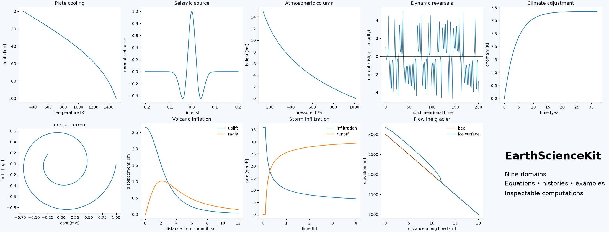

earthsciencekit: Earth-System Models in Python
==============================================

.. include:: /_generated/vars.rst

**EarthScienceKit** makes the equations behind |num_subpackages| Earth-science
domains computable, inspectable and visualizable. Choose a domain to explore
its history, run its examples and inspect its API. NumPy and SciPy provide the
numerical foundations; this package connects them to Earth-system concepts.

Browse by domain
----------------

.. include:: /_generated/grid_hub.rst

Start here
----------

:doc:`quickstart` introduces the API. :doc:`numerical_methods` explains sampled
histories and solver choices. The model guides give equations, units, conventions
and applicability limits. :doc:`validation` documents the evidence behind this
release and :doc:`limitations` describes its scope.

.. code-block:: python

   import numpy as np
   from earthsciencekit.climate import simulate_one_box
   from earthsciencekit.units import convert

   time = convert(np.linspace(0, 100, 201), "year", "s")
   result = simulate_one_box(4, 1.2, 2e8, time)
   print(result.summary())
   figure, axes = result.plot()

.. toctree::
   :maxdepth: 2
   :caption: Subpackages
   :hidden:

   subpackages/index

.. toctree::
   :maxdepth: 2
   :caption: History
   :hidden:

   history/index

.. toctree::
   :maxdepth: 2
   :caption: Examples
   :hidden:

   examples/index

.. toctree::
   :maxdepth: 2
   :caption: API
   :hidden:

   api/index

.. rubric:: Related toolkits

Sibling Python toolkits for learning and teaching, built the same way:

- `blockchainkit <https://cpoli.github.io/blockchainkit/>`__ -- cryptography, consensus and blockchain systems
- `chemistrykit <https://cpoli.github.io/chemistrykit/>`__ -- computational chemistry
- `engineeringkit <https://cpoli.github.io/engineeringkit/>`__ -- computational engineering
- `financialkit <https://cpoli.github.io/financialkit/>`__ -- quantitative finance
- `mathematicskit <https://cpoli.github.io/mathematicskit/>`__ -- computational mathematics
- `physicskit <https://cpoli.github.io/physicskit/>`__ -- computational physics
- `tbkit <https://cpoli.github.io/tbkit/>`__ -- tight-binding models, band topology and quantum transport
